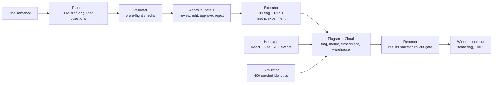

# TogglePilot

Describe an A/B test in one sentence. TogglePilot checks the setup for silent failures, shows you the plan, waits for your approval, launches the experiment on Flagsmith, and tells you the winner in plain English.

## The claim, measured

TogglePilot catches the five silent failures that make experiments report zero. The dashboard catches none of them before launch.

| | Manual (dashboard) | TogglePilot |
|---|---:|---:|
| Wall-clock time | ~2 min (26 Nov 2026, 09:04-09:06 IST) | 8.5 s (CLI start to creation and verification; first-time human reading excluded) |
| Screens touched | 10 | 1 (the terminal) |
| Silent-failure traps checked | 0 of 5 | 5 of 5 passed |
| Approvals before anything mutates | None (no gate) | 3 (plan, start, rollout) |

The manual side was timed by hand in the Flagsmith dashboard on 26 Nov 2026: warehouse check, multivariate flag, metric, experiment wizard, 10 screens in order, 0 of 5 traps checked. The TogglePilot side comes from the Slice 1 run record (`runs/2026-11-26T09-21-53.256Z/run-record.md`): CLI start 09:21:51 UTC, plan approval 09:21:53, execution finished 09:21:59. Speed was considered as the claim and struck out. A 2 minute manual baseline is too fast to beat on camera with margin, so the entry stands on safety. Full numbers and the manual screen list are in `scorecard.md`.

## Live demo and video

- Live host app: https://togglepilot-host.vercel.app (serves the winning headline to every new visitor since the rollout)
- Demo video: `runs/demo-video/togglepilot-demo.mp4` (YouTube upload pending, link to be added here once live)
- Repository: https://github.com/pintu544/togglepilot
- The live experiment: experiment 590, completed 26 Nov 2026. Variant_1 (shorter headline) won with 99.41% probability and was rolled out to 100% on the same flag.

## How it works

One workflow, end to end, in the terminal:

1. `togglepilot run "Test whether a shorter headline lifts clicks on my landing page"` drafts a plan: flag name, variants with keys and labels, metric, rollout, split, and a hypothesis in Flagsmith's own format (change, metric, expected effect, timeframe). The draft comes from an OpenAI-compatible LLM call when `TOGGLEPILOT_LLM_*` is set, or from guided questions when it is not. The plan object is identical either way.
2. The pre-flight validator runs five checks before anything is created: a warehouse is connected, every variant has a key and label, the metric event name matches the app's event exactly, the app's Flagsmith SDK versions meet the minimums (`@flagsmith/flagsmith` 12.4.0+, `@flagsmith/nodejs` 9.1.0+), and the instrumentation identifies the user and flushes events. Any failure stops the run with the fix in plain English and nothing created.
3. You review the plan, edit any value, then approve or reject. Rejection ends the run with nothing created.
4. On approval, TogglePilot creates the flag and variants, then the metric and the experiment, and re-reads each object to verify it exists as intended.
5. It prints a React/TypeScript instrumentation snippet for your app. The snippet initialises the SDK with `enableEvents: true`, identifies a persistent identity, records exposure at the render point, tracks the exact metric event, and flushes.
6. A second, separate approval starts the experiment. Results are read on demand with `togglepilot results`, which prints identities and conversions per arm, lift, the 95% credible interval, win probability, and the results' "as of" time. It renders "Collecting data" while the floors are unmet (under 50 identities or under 5 conversions per arm) and warns on sample ratio mismatch.
7. When win probability passes 95%, `togglepilot rollout` recommends the winner. A third approval rolls the winner out to 100% on the same flag and ends the experiment.

Flagsmith's own free coding-agent prompt does the naive version of this setup. It has no approval gates, no pre-flight validation, and no results interpretation or rollout step. TogglePilot is the distance from that prompt: the validator catches failures before creation instead of after errors, three gates keep a human in control, and the results narrator turns a results link into a decision.

## How Flagsmith is used

Flagsmith is the whole product. Remove it and nothing remains.

- Flag: a multivariate flag holds the versions. The flag's own value is the control; each variant has a key, a label, and a value. Created with the Flagsmith CLI v2 (`flagsmith feature create`, `flagsmith feature variant add`, `flagsmith feature get` to verify).
- Metric: created with `POST /api/v1/environments/<key>/experiment-metrics/`. The demo metric is `cta_clicked`, Occurrence, higher is better. An existing metric with the same event is reused, not duplicated.
- Experiment: created with `POST /api/v1/environments/<key>/experiments/` (flag, hypothesis, primary metric, rollout, split) and started with `POST /api/v1/environments/<key>/experiments/<id>/start/`, only after the second approval.
- Warehouse: the validator checks `GET /api/v1/environments/<key>/warehouse-connections/` before creation. The demo runs on the managed Flagsmith warehouse on Cloud Free.
- Results: read from the Management API for the experiment id and rendered in plain English, with the 5 minute refresh limit respected and the "as of" time printed.
- Rollout: the winning variant is applied to the same flag at 100% and the experiment is ended (`POST /api/v1/environments/<key>/experiments/<id>/complete/`).

The MCP server is deliberately not used for creation or start. Flagsmith's own coding-agent guide says: "Don't use the Flagsmith MCP server: it can't start experiments." (https://docs.flagsmith.com/experimentation/set-up-with-a-coding-agent). TogglePilot drives the CLI and the REST Management API instead, and says so in the code. Management API auth is `Authorization: Api-Key <key>`.

## Architecture



One TypeScript/Node CLI, five components in one process: planner, validator, executor (the only part that mutates Flagsmith, and only behind the gates), reporter, and the CLI shell. The host app and the simulator are satellites that exist to give the demo a real experiment. TogglePilot holds no database. Its state is the plan JSON, the pre-flight report, and one run record per run under `runs/`, plus the Flagsmith objects themselves.

## Run it yourself

Under 10 minutes on the Flagsmith Cloud Free tier (50,000 API requests a month, 100,000 experiment users). You need Node 20+, git, and a Flagsmith Cloud account with a project and an environment that has the managed warehouse connected (Environment Settings, Warehouse).

```sh
git clone https://github.com/pintu544/togglepilot
cd togglepilot
npm install
```

Install the Flagsmith CLI v2 (https://get.flagsmith.com serves the installer):

```sh
curl -fsSL https://get.flagsmith.com | sh
```

Copy `.env.example` to `.env` and fill in the two keys. Never commit `.env`.

```sh
cp .env.example .env
```

`FLAGSMITH_API_KEY` is the Management API key (Organisation Settings, API Access). `FLAGSMITH_ENVIRONMENT_KEY` is the environment SDK key (Environment Settings, SDK Keys). The CLI authenticates from `FLAGSMITH_API_KEY`; no `flagsmith login` is needed for these commands.

```sh
npm run build
node dist/cli.js run "Test whether a shorter headline lifts clicks on my landing page" --flag my_headline_test --metric-event cta_clicked --app-path host-app
```

Answer the guided questions (press Enter to accept each default), review the plan, edit one value if you like, and approve. The run creates the flag, reuses or creates the metric, and creates the experiment without starting it. Then start it after your second approval:

```sh
curl -X POST -H "Authorization: Api-Key $FLAGSMITH_API_KEY" \
  "https://api.flagsmith.com/api/v1/environments/$FLAGSMITH_ENVIRONMENT_KEY/experiments/<id>/start/"
```

Read the results and, when a winner clears 95%, roll it out:

```sh
node dist/cli.js results --experiment-id <id>
node dist/cli.js rollout --experiment-id <id> --dry-run
node dist/cli.js rollout --experiment-id <id>
```

Every command above was run against the live project during the build window. The rehearsal on 26 Nov 2026 used a fresh flag (`rehearsal_headline_cta`, experiment 633): a planted unlabelled-variant plan failed pre-flight with nothing created, the fixed plan passed 5 of 5, one value was edited at the gate, the flag and experiment were created in a 19 second run, the experiment started, a 20 identity cohort ran through the real pipeline in 8 seconds, results read "Collecting data" (floors unmet at 20 identities), and the rollout dry run said "No conclusive winner. Keep running." with no mutation.

Run the tests with `npm test` and typecheck with `npm run typecheck`.

## Honesty box

- The live experiment ran on a seeded cohort, not organic traffic. 400 identities, each assigned its arm by Flagsmith, converted at fixed probabilities of about 30% for control and 42% for the variant. Actual results: control 219 identities, 64 conversions (29.2%); Variant_1 181 identities, 80 conversions (44.2%). The rates were committed in `simulator/src/constants.js` before the experiment started and were not changed after it started.
- The verdict quoted everywhere is the live API read: lift 51.24%, 95% credible interval 11.34% to 91.15%, win probability 99.41%, as of 2026-11-26T11:21:34Z. The results readout prints the same disclosure next to the numbers.
- Free-tier use is a best-effort tally, not a metered count. The rehearsal added about 60 API requests (pre-flight checks, creation calls, start, 20 SDK evaluations with event flushes, two results reads). The 400 identity cohort added about 400 flag evaluations plus event batches; the warehouse counter showed 552 events received at the last check. The total sits far below the 50,000 request monthly cap, but Flagsmith publishes no live usage counter the CLI can read, so the figure is a counted estimate and is labelled as one.
- The 8.5 second TogglePilot setup time excludes first-time human reading and approval. The manual 2 minute baseline is a measured time, not an estimate.
- The warehouse dashboard still showed `pending_connection` at the last API check (26 Nov 2026, 552 events received, last event 12:12:59 UTC) even though events and results flow through the API. Results in this repo come from API reads, not from the dashboard status.
- The manual baseline run was timed and logged in `scorecard.md`. No video file of that run is in the repo, so the demo video shows the measured numbers as on-screen text rather than replaying the recording.
- AI tools used: Codex CLI and Kiro CLI (JetBrains AI) for building, and the planner drafts through an OpenAI-compatible LLM endpoint (FastRouter) when `TOGGLEPILOT_LLM_*` is set. When no LLM is configured the planner falls back to guided questions and produces the identical plan shape. Every number in this file was verified against a live API read.

## What's next

- A second experiment on the host app with a new question, reusing the same workflow.
- Snippet generators beyond React/TypeScript, starting with the Node server-side pattern already documented in the code.
- A scheduled results refresh that stays inside the 5 minute computation limit, instead of the current on-demand read.
- The rehearsal experiment 633 is still running with 20 identities. It was left running after the rehearsal because its verdict was inconclusive, and it will be ended before the next demo run.
